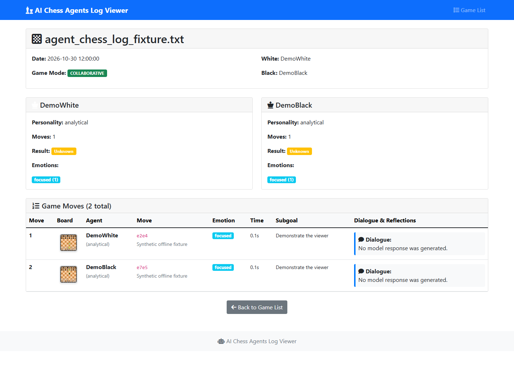

# Experimental AI chess agents and log viewer

A Python experiment combining chess moves, generated dialogue, personality labels
and JSON memory, with a Flask viewer for saved game logs. No playing-strength
benchmark or reliable autonomous learning result has been established.



This is the actual local viewer with synthetic data. No model response or paid
API request was generated during this review.

## Scope

- `ai_chess_agents.py` uses python-chess, OpenAI calls, dialogue, memory and exports.
  Live runs need `OPENAI_API_KEY` or `API_KEY` in the Windows user environment
  and can incur API usage. Keep secrets out of files. Model availability, output
  quality and live feedback behavior were not verified.
- `chess_log_viewer.py` browses saved exports and SVG boards. It is an offline
  log viewer, not a live game stream.
- `simple_chess.py` is a separate console toy with incomplete movement, ownership,
  obstruction and check handling; it is not the agent experiment's legal-move engine.
- `test_feedback_system.py` is an API-dependent demonstration that can update memory.
  It is separate from the offline regression suite and was not run here.

## Setup and offline example

Verified on Windows with CPython 3.13.16. Direct requirements pin python-chess 1.999,
OpenAI 1.88.0, python-dotenv 1.0.0 and Flask 3.1.0; transitive packages are not locked.

```powershell
git clone https://github.com/boyInShadows/AutoAiChessGame.git
cd AutoAiChessGame
python -m venv .venv
.venv\Scripts\python -m pip install -r requirements.txt
```

The review installed these requirements in an isolated uv-created environment
and passed dependency consistency checks. To browse bundled logs without model calls:

```powershell
.venv\Scripts\python -m flask --app chess_log_viewer run --host 127.0.0.1 --no-debugger
```

Open <http://127.0.0.1:5000>, select a game, and inspect moves and boards.
The [viewer guide](docs/web-viewer.md) explains the log format. Live agent runs
write memory, logs and SVGs relative to the working directory; preserve bundled
examples before experimenting.

## Verification and limits

```powershell
.venv\Scripts\python -m unittest discover -s tests -v
```

On 2026-10-30, all three offline regressions passed: indented move fields,
missing-log errors and HTML escaping of generated reflections/feedback. The
corresponding tests failed before the fixes; an inverted parser condition was
also caught. Synthetic list/detail/404/SVG checks passed, and Edge rendered both
board images without page errors. No complete AI game, paid API feedback, physical
mobile acceptance or whole-project security audit was performed.

The viewer is for trusted local logs. Access control, filename boundaries and
production deployment need further review. The original direct-script entry point
starts a network-visible debug server; use the loopback Flask command above.

## License

Copyright (c) 2025–2026 Ramtin Farzane.

The original project code and documentation are free software under the
GNU General Public License, version 3 or (at your option) any later version
(`GPL-3.0-or-later`). See [LICENSE](LICENSE) for the full terms and warranty
disclaimer.

Third-party packages and artwork retain their own copyrights and license terms.
In particular, python-chess uses GPL-3.0-or-later, and the board images include
Colin M. L. Burnett's chess-piece artwork. See [third-party notices](docs/third-party-notices.md).
